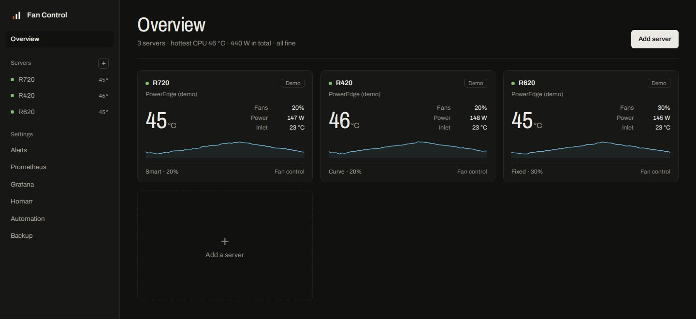
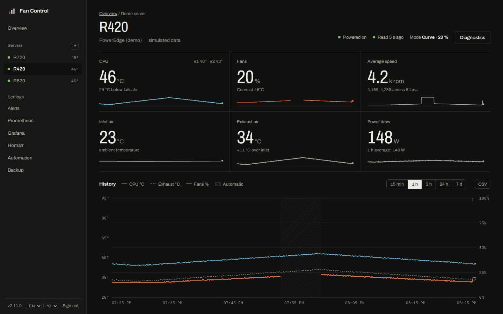
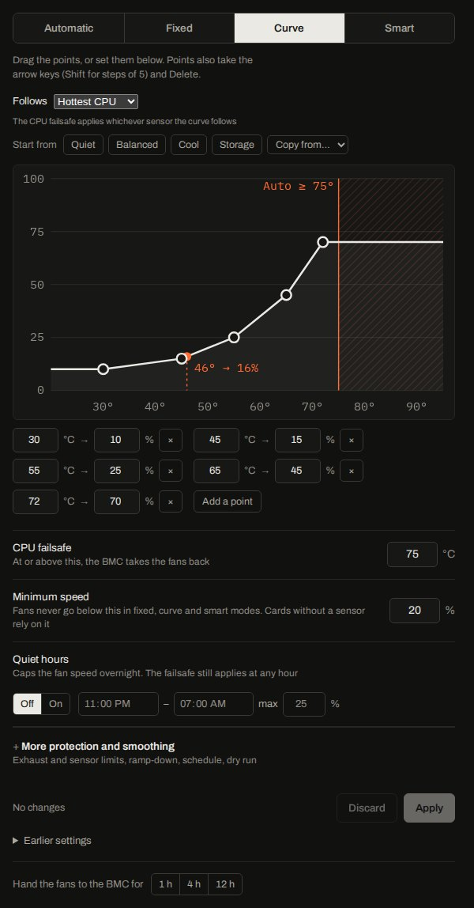
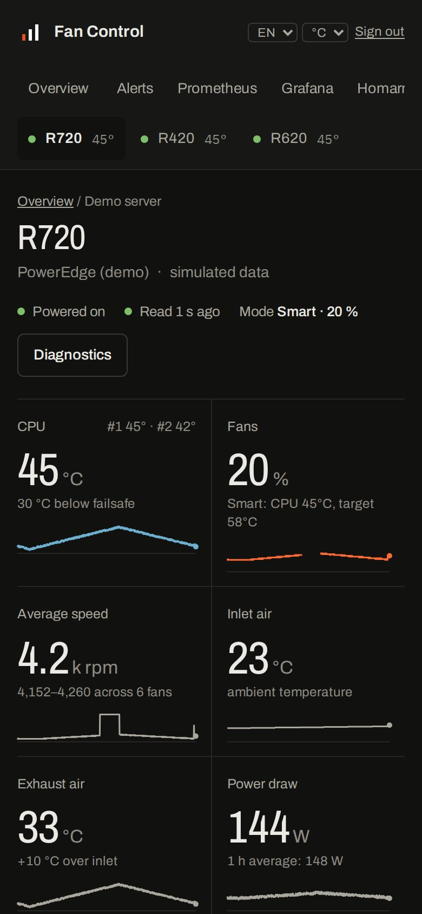
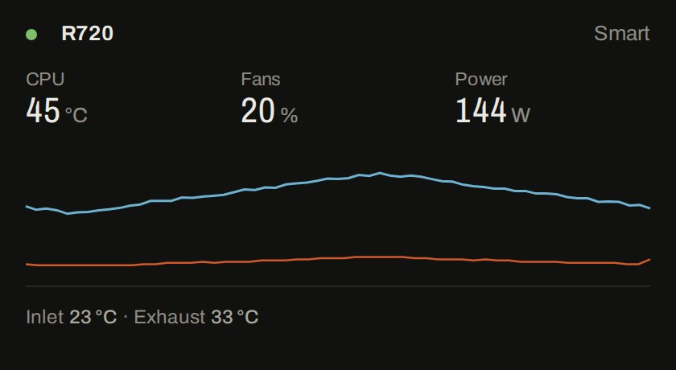
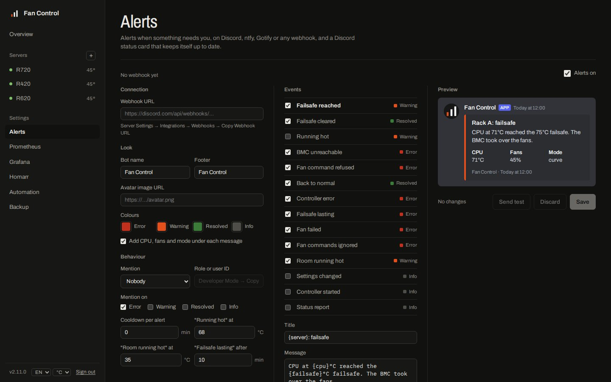

<p align="center">
  
</p>

<h1 align="center">Fan Control</h1>

<p align="center">
  <b>Quiet rack servers, without cooking them.</b><br>
  Self-hosted fan control for Dell PowerEdge, Supermicro and HPE ProLiant, with a smart mode that learns
  your server, and the BMC as the safety net.
</p>

<p align="center">
  <a href="https://github.com/ST-DEVPT/rack-fan-control/actions/workflows/docker.yml"></a>
  <a href="https://github.com/ST-DEVPT/rack-fan-control/releases"></a>
  <a href="https://github.com/ST-DEVPT/rack-fan-control/pkgs/container/rack-fan-control"></a>
  
  
  <a href="LICENSE"></a>
</p>

<p align="center">
  <a href="#quick-start">Quick start</a> ·
  <a href="#supported-hardware">Hardware</a> ·
  <a href="#fan-control">How it works</a> ·
  <a href="#protection">Safety</a> ·
  <a href="#integrations">Integrations</a> ·
  <a href="CHANGELOG.md">Changelog</a>
</p>

<p align="center">
  
</p>

## Why

Rack servers are made for datacenters, where nobody minds the noise. In a homelab the factory fan profile
runs loud, and the usual fix, an `ipmitool` script in cron that pins the fans low, has a flaw: when the
script dies, the fans stay low and nobody is watching the temperature.

Fan Control takes over the fans only while it is sure it should. It reads every sensor the BMC has, holds the
temperature you choose with as little fan as possible, and hands the fans back to the BMC the moment anything
is unknown: a missing reading, a sensor that disappears, a failed fan, a command the BMC ignores, a crash or
a container stop. A watchdog restarts it if it stalls, and a small script on the host covers it being killed.

## At a glance

<p align="center"></p>

<table>
  <tr>
    <td valign="top" width="50%"></td>
    <td valign="top" align="center">
      <br><br>
      
    </td>
  </tr>
</table>

- **Four ways to drive the fans**: automatic (the BMC), fixed, a curve you drag, or **smart**, which learns the
  speed each load needs on your server, sees heat coming before it arrives and rides out short bursts.
- **Protection first**: a CPU failsafe, an exhaust air limit, every sensor's own BMC warning level, a minimum
  speed, a dry run to try things out. The BMC takes over whenever anything is wrong or unknown.
- **Every server in one place**: scan your network for BMCs, let each say what it is, test it, add it.
  Monitoring-only servers (any Redfish or IPMI BMC) get the same history, alerts and metrics.
- **Quiet hours and schedules**: cap the fans at night, or by day and hour, without giving up protection.
- **Alerts** on Discord, ntfy, Gotify or any webhook: failsafe, failed fan, ignored commands, a hot room.
- **Prometheus metrics**, a **Grafana** dashboard, alert rules, and **Homarr** widgets that share only what
  you choose.
- **Made to be left alone**: plain Python with no dependencies, a non-root read-only container, read-only
  accounts, revocable sessions and tokens, backups, English and Portuguese, °C and °F.

## Contents

[Supported hardware](#supported-hardware) ·
[Quick start](#quick-start) ·
[Configuration](#configuration) ·
[Fan control](#fan-control) ·
[Alerts](#alerts) ·
[Integrations](#integrations) ·
[Diagnostics](#something-wrong-with-your-hardware) ·
[Accounts and security](#accounts-and-security) ·
[Backup](#backup) ·
[Troubleshooting](#troubleshooting) ·
[Upgrading](#upgrading) ·
[Development](#development) ·
[Contributing](CONTRIBUTING.md)

## Supported hardware

| Type | Servers | Fan control | Reads |
| --- | --- | --- | --- |
| **Dell PowerEdge (iDRAC)** | iDRAC 6, 7, 8, and iDRAC 9 up to firmware 3.30.30.30 | Yes | IPMI |
| **Supermicro** | X10, X11 and X12 boards | Yes, experimental | IPMI |
| **HPE iLO 4, unlocked firmware** | ProLiant Gen8 / Gen9 with the community-patched iLO 4 2.77 | Yes (caps over SSH), experimental | Redfish |
| **Redfish** | HPE iLO 4 (2.30+), iLO 5, iLO 6, Lenovo XCC, Dell iDRAC 9, most recent BMCs | Monitoring only | Redfish |
| **Other IPMI** | Any BMC with IPMI over LAN | Monitoring only | IPMI |
| **Demo** | Simulated readings | Yes (simulated) | — |

Monitoring only means the vendor firmware offers no way to set fan speed. Those servers still get the
overview card, history, alerts, reports, metrics and the widget, which is often enough to find what makes
a server loud: on HPE, a third-party PCIe card or disk the iLO cannot read is the usual cause.

Dell iDRAC 9 from firmware 3.34.34.34, and iDRAC 10, no longer accept fan commands: add them as Redfish.
Not sure what you have? **Scan network** and **Detect** on the *Add server* page ask the BMCs and pick the
type for you. The scan only accepts private ranges, up to a /22, and only an admin can run it.

## Quick start

**1. Run the container**

```bash
mkdir fan-control && cd fan-control
curl -O https://raw.githubusercontent.com/ST-DEVPT/rack-fan-control/main/docker-compose.yml
mkdir data && chown 1000:1000 data
```

Set `WEB_PASSWORD` (and `TZ`) in `docker-compose.yml`, then:

```bash
docker compose up -d
```

**2. Open `http://<docker-host>:8080`**, sign in, and choose **Add server**.

**3. Find your servers**: **Scan network** probes a private range (for example `192.168.1.0/24`) for BMCs
answering Redfish or IPMI and suggests the type of each; **Use** fills in the form. Or enter one address and
press **Detect**, or pick the hardware yourself. Fill in the user and
password and press **Test connection**: it reads the BMC once and shows the model, sensors and power draw
before anything is saved.

Before adding a server, prepare its BMC:

- **Dell**: enable **IPMI over LAN** (iDRAC Settings → Network → IPMI Settings); the user must be an Administrator.
- **Supermicro**: IPMI over LAN is on by default; use an Administrator account.
- **HPE and other Redfish**: any account that can read the system health. Redfish uses HTTPS (port 443).
- **HPE iLO 4 unlocked**: SSH (port 22) and HTTPS must both be reachable, and the firmware must be the patched 2.77.

Images are built for `linux/amd64` and `linux/arm64`. Use the major version tag,
`ghcr.io/st-devpt/rack-fan-control:2`: it takes every fix and feature of 2.x and never a change that breaks
your settings. `:latest` follows the main branch, `:2.2` or `:2.2.0` pin a release.

## Configuration

Servers, fan settings and Discord are configured in the dashboard. The environment holds the rest:

| Variable | Default | Description |
| --- | --- | --- |
| `WEB_PASSWORD` | empty | Admin password. Empty disables sign-in; only do that on a trusted network |
| `VIEW_PASSWORD` | empty | Optional read-only account: sees everything, changes nothing |
| `TZ` | UTC | Time zone for quiet hours and the event log, e.g. `Europe/Lisbon` |
| `CHECK_INTERVAL` | `15` | Seconds between readings and fan commands. Minimum 5 |
| `DISCORD_WEBHOOK_URL` | empty | Default Discord webhook. A webhook pasted in the dashboard takes precedence |
| `METRICS_TOKEN` | empty | A metrics token for `/metrics` (`Authorization: Bearer <token>`). Tokens can also be created on the Prometheus page |
| `EMBED_TOKEN` | empty | A widget token for `/embed?token=` and `/api/widget`. Tokens can also be created on the Homarr page |
| `LOG_FORMAT` | text | `json` prints one JSON object per log line (time, level, logger, server, message) for Loki, Graylog and the like |
| `UPDATE_CHECK` | `true` | Asks GitHub twice a day for the latest release, and shows it in the sidebar when it is newer. `false` turns it off |
| `TRUST_PROXY` | off | Set to `true` behind a reverse proxy, so sign-in limits and the event log use `X-Forwarded-For` |
| `ALLOWED_HOSTS` | (none) | Only without `WEB_PASSWORD`: host names the dashboard answers besides addresses, `localhost` and local names (`.lan`, `.local`, no dots), e.g. `fans.example.com`. A guard against DNS rebinding |
| `TRUSTED_PROXIES` | loopback and Docker networks | Addresses or networks (comma separated) whose `X-Forwarded-For` is believed, e.g. `192.168.1.10` for a proxy on another machine |
| `PORT` | `8080` | HTTP port inside the container |

### Servers in the environment

Servers can also be declared in `docker-compose.yml`, for example to keep credentials in a `.env` file.
They show up in the dashboard like the others, but can only be changed in the environment:

```yaml
    environment:
      SERVER_1_NAME: Compute
      SERVER_1_DRIVER: dell              # dell, supermicro, ilo4-unlocked, redfish, ipmi or demo
      SERVER_1_HOST: 192.168.1.120       # "local" for IPMI from the server itself
      SERVER_1_USERNAME: root
      SERVER_1_PASSWORD: ${COMPUTE_BMC_PASSWORD}
      SERVER_2_NAME: DL360
      SERVER_2_DRIVER: redfish
      SERVER_2_HOST: 192.168.1.121
      SERVER_2_USERNAME: Administrator
      SERVER_2_PASSWORD: ${DL360_ILO_PASSWORD}
      SERVER_2_VERIFY_TLS: "false"       # BMCs ship self-signed certificates
```

The 1.x variables still work and keep their settings: `IDRAC_HOST`, `IDRAC_USERNAME`, `IDRAC_PASSWORD`,
`IDRAC_NAME` for one server and `IDRAC_1_HOST`, ... for several.

### What is stored in `/data`

| File | Contents |
| --- | --- |
| `servers.json` | Servers added in the dashboard, with their BMC passwords (file mode 600, never sent to the browser) |
| `settings.json`, `settings-<server>.json` | Mode, curve, targets, limits, quiet hours and the other fan settings |
| `history-<server>.json` | Three hours of readings, seven days of 5-minute averages, and the events |
| `alerts.json` | Alert settings, including the Discord webhook and the ntfy, Gotify and webhook addresses and tokens (file mode 600, never sent to the browser) |
| `smart-<server>.json` | What smart mode learned: the fan speed each heat load needs |
| `sessions.json` | Sign-in sessions that were signed out before they expired (file mode 600) |
| `redfish-pins.json` | The certificate each Redfish BMC showed first (trust on first use) |
| `supermicro-<host>.json` | The fan mode a Supermicro BMC had before Fan Control, given back on release |
| `*.corrupt-<time>` | A file that could not be read, kept aside for a look |
| `calibration-<server>.json` | The last fan calibration: RPM and power draw at each speed |
| `handover-<server>.json` | Until when the fans are handed to the BMC, while they are |
| `changes-<server>.json` | The last 20 settings saved, with who saved them and when |
| `widget.json` | Which fields widgets may show |
| `tokens.json` | Widget and metrics tokens, as SHA-256 hashes (file mode 600) |
| `report-state.json` | Which Discord message the status card is edited into |
| `known_hosts` | SSH host keys of unlocked iLO 4 servers, recorded on first connection |
| `secret` | Key that signs sign-in sessions. Delete it to sign everyone out |

## Fan control

For servers whose type has fan control (Dell, Supermicro, unlocked iLO 4):

| Mode | What happens |
| --- | --- |
| **Automatic** | The BMC runs its factory profile. Loudest, and the fallback for every problem |
| **Fixed** | Every fan at one speed |
| **Curve** | Speed follows a temperature along points you drag: the hottest CPU, the exhaust air, or any sensor (a GPU, a disk bay). Start from a preset (quiet, balanced, cool, storage) or copy another server's curve. The CPU failsafe applies whichever it follows |
| **Smart** | Holds the CPU at a target you set with as little fan as it can, learning what each load needs, and keeps every other sensor clear of its limits |

### Smart mode

Smart mode watches the CPU against its target, the exhaust air against 8 °C below its limit, and every
sensor with a BMC warning threshold against 8 °C below the point where the failsafe would trip. Inlet air
is left out: no fan speed cools the room. It answers to whichever is worst, in four ways:

- **It learns your server.** Whenever a load has been held steady at the target for a minute, it remembers
  the fan speed that did it, against the heat load: power draw over the room left between the inlet air
  and the target. When that load comes back, the fans go straight to what worked last time instead of
  waiting for the heat. A warm day or a new target needs no relearning, because the heat load already
  accounts for both. The server page draws what it has learned; **Forget** starts it afresh. It learns
  nothing during a dry run.
- **It looks ahead.** Each temperature is judged where its trend over the last minute puts it 40 seconds
  later, so a CPU that is climbing gets air before it arrives.
- **It corrects itself.** A proportional and integral trim on top fixes what the learned map gets wrong,
  and the map slowly takes the correction over.
- **It stays quiet.** Fans rise at once, but fall only after lower demand has lasted the ramp-down delay,
  and then slowly, so a job that comes and goes every minute leaves them steady. Corrections under 2 %
  are ignored. At idle it rests on the minimum speed.

When something heads for its trip point, smart mode **boosts** the fans by 25 % at once, so the BMC rarely
has to take over. Under the learned map, the panel says how it has been doing over the last hours: how
often the CPU was within 2 °C of the target, the average fan speed, and how often the fans changed
direction; the history chart draws the target as a dotted line. During quiet hours the cap gives way gradually from 8 °C below a trip point: louder fans
beat a failsafe.

### Protection

The BMC takes over, whatever the mode, when:

- the hottest CPU reaches the **CPU failsafe**;
- the exhaust air reaches the **exhaust air limit** (on by default, empty turns it off);
- any sensor comes within the margin (5 °C by default) of the **warning threshold its BMC defines**:
  PCIe cards, disks, DIMMs, the RAID controller, which a CPU-only curve would never see;
- anything is unknown: there is no CPU reading (no other sensor ever stands in for the CPU), the BMC
  cannot be read (the fans are handed back as soon as it takes a command again), a temperature sensor
  that was there stops reporting or reports a fault, a fan fails, or the BMC ignored the last fan command;
- the server is off, a fan command is refused, the control loop fails or stalls, the server is removed or
  the container stops.

Once a limit trips, the BMC keeps the fans for at least 5 minutes, and manual control resumes only when
things are 3 °C below the limit, starting from 50 % and easing down; so the fans don't flap at the edge.
Fans never run below the **minimum speed**: 20 % by default, anything from 0 % up. Cards without a sensor
(HBAs, NICs, NVMe drives, GPUs) are cooled by that airflow alone, so lowering it asks for confirmation, and a
fan that stops while the others spin still trips the failsafe. Supermicro boards never go below 25 %, where
their fans would read under the BMC's lower critical RPM. The failsafe can be set up to 90 °C.

**Each fan's BMC minimum.** The BMC defines a lowest RPM for each fan (`ipmitool sensor`, or Redfish's lower
thresholds); under it, it logs an event, lights the amber LED and often runs every fan at full speed. The fan
list shows it next to each fan (`/ ≥600`). When a fan reads under it at the speed Fan Control sent, the fans
stay 5 % above that speed from then on (until a restart), and the event log says so. The minimum speed field
warns when the calibration shows a fan would turn under its minimum at that speed.

When the controller hands a Supermicro back, the BMC gets the fan mode it had before (Standard,
Optimal or HeavyIO), read once and kept in the data folder. On `docker stop` every server is released at
the same time; the example compose file gives it 60 s (`stop_grace_period`), where Docker's default is 10 s.

**If the BMC takes the fans back.** Some BMCs return to their own control without a word: an iDRAC 7 did
while its host started, and then ignored the manual-mode command sent every cycle. So every time Fan
Control takes the fans (when it starts, after a failsafe, a hand-over, a dry run or a refused command, on a
change from automatic) it lets go and takes hold again: on Dell also looking for the fans afresh, on
Supermicro switching to Full mode again, on iLO 4 re-sending the caps. It does the same when the host
powers on and twice more while it starts up, and when the BMC answers again after a silence. And it checks, at a steady
speed, that the fans turn as fast as that speed made them turn before (the calibration's measurements, or
what it saw itself): when they do not, the page and the event log say so, the *fan commands ignored* alert
goes out, `fanctl_fans_following` drops to 0, and it takes them back every 5 minutes until they follow. The
BMC has them meanwhile, which is safe, so this is no failsafe.

**If the BMC cannot be reached at all**, nothing can hand the fans back: a Dell or Supermicro BMC keeps the
last manual speed until it is told otherwise. The page and the *BMC unreachable* alert say so at once, so keep
the minimum speed one the server can live with for a while, and the BMC on a network path that does not
fail with the one to the host. One failed reading is not enough (a busy BMC drops some): two in a row are.

**If the controller itself stops.** A control loop that stops turning for 3 minutes (or 10 intervals,
when longer) trips a watchdog:
every fan goes back to its BMC and the process exits, so Docker's restart policy (`restart:
unless-stopped`) starts a fresh one. The image's health check reads `/livez`, which follows the control
loops and not the BMCs. What no process can cover is its own sudden death (`kill -9`, out of memory,
Docker gone): the BMC then keeps the last manual speed. For that, run
[`scripts/fan-guard.sh`](scripts/fan-guard.sh) from root's cron every minute. It finds the Fan Control
container by its image, and when it has not been running healthy for two minutes in a row (or Docker
itself is down) it hands the fans back to the BMC: Dell and Supermicro with `ipmitool`, HPE iLO 4
unlocked over SSH. A container that was removed on purpose is left alone.

```bash
* * * * * /root/docker/fan-guard.sh >> /var/log/fan-guard.log 2>&1
```

It reads the servers from the `.env` next to it (`chmod 600`; it refuses one the group or others can
write), as plain `KEY=value` lines, never as shell code: the `SERVER_1_HOST`, `SERVER_1_USERNAME`,
`SERVER_1_PASSWORD`, `SERVER_1_DRIVER`... of the compose file, the 1.x `IDRAC_HOST`..., or names of your
own: `GUARD_SERVERS="R420 X11"`, then `R420_HOST`, `R420_USERNAME`, `R420_PASSWORD` and `R420_DRIVER`
(`dell`, `supermicro` or `ilo4-unlocked`). **Servers added only in the dashboard must be listed there too**:
with no server at all the guard logs it and fails, rather than guarding nothing in silence. Docker calls
time out after 15 s, one run at a time, and a container that is running but *unhealthy* (a slow health
check) is only acted on after 5 minutes.

**Dry run** decides and logs what it would send ("Dry run: would set fans to 25%"), but leaves the fans
to the BMC. Use it to try a new server type or a new curve.

### Smoothing and quiet hours

**Ramp-down delay**: fans speed up at once but slow down only after the lower speed has been asked for
during the whole delay. It never runs the fans slower than the curve. Smart mode uses it the same way.

**Quiet hours** cap the speed between two times of day, for example 23:00 to 07:00 at 25 %. Protection
still applies at any hour.

**Schedule**: up to 8 profiles by day and time, each with a speed cap, a smart mode target, or both. For
example *Weekend*, Saturday and Sunday all day, at most 30 %; or *Office hours*, Monday to Friday 09:00 to
18:00, smart target 55 °C. A profile from 22:00 to 06:00 runs into the next morning; 00:00 to 00:00 is the
whole day. When several are in force, the lowest cap and the lowest target win, together with quiet hours.

### Fan calibration

**Calibrate fans**, under the server's fan list, finds what the minimum speed is best set to. It steps the
fans from 100 % down to 0 % (12 steps, about 6 minutes, loud at first), measures each fan's RPM and the
server's power draw at every step, and draws the curve. It then says below which speed the fans turn no
slower (many fans have a floor of their own, so a lower setting only adds risk), the lowest speed at which
every fan kept turning, and how many watts the fans cost at full speed; **Use N % as minimum speed** puts
that into the settings. From the same measurements it estimates what the fans draw now (and in kWh a
month), and over the last 7 days while Fan Control had them against while the BMC had them. Every protection stays on while it runs. The failsafe, a fan that stops, a BMC that
ignores a command, the CPU warming by 10 °C, a dry run or a hand-over stop it, and the steps measured
until then still count. It never takes a fan under its BMC minimum: it goes no slower once a fan is within
15 % of it. Quiet hours do not cap it: it was started by hand. It needs fans that report RPM.

### Earlier settings and the BMC's event log

**Earlier settings**, under **Apply**, lists the last 20 settings saved for the server: when, by whom (an
account and its address, or a control token's name) and what changed. **Load** puts one back in the panel,
to check and apply like any change.

**BMC event log**, under the events, reads the BMC's System Event Log when opened (IPMI servers: Dell,
Supermicro and plain IPMI): how full it is and the last 25 entries, newest first. A full log stops
recording, and fans run under their minimum show up there, so it is worth a look after lowering the
minimum speed. An admin can clear it.

### Handing the fans to the BMC for a while

Under **Apply**: hand the fans to the BMC for 1, 4 or 12 hours, for maintenance, a firmware update or a
stress test, and control comes back on its own at the end (or with **Take back now**). It is kept in the
data folder, so a restart neither cuts it short nor makes it last for ever. The API takes any time up to a
week: `POST /api/handover?server=<id>` with `{"minutes": 90}`, and `{"minutes": 0}` to take them back.

### A starting point

For a quiet homelab server with Xeon E5 processors, the **Quiet** preset (35 °C → 12 %, 45 → 15, 55 → 22,
62 → 35, 68 → 55) with a 72 °C failsafe, or **Smart** with a 60 °C target. Some BMCs raise fan alarms below
about 10 %. With third-party PCIe cards installed, stay at 15 % or above, and on Dell leave the
third-party PCIe cooling response **On**.

**Per vendor.** Dell gets one IPMI command for all fans; some 11th-generation servers refuse it, and the
controller then finds the fans they accept and sets them one by one. Supermicro is switched to *Full* fan
mode once, then both zones are set; it goes back to *Optimal* when released. An unlocked iLO 4 gets a cap on
every fan over SSH (`fan p N max`), so its own curve still runs underneath; releasing removes the cap.

## Alerts

Open **Alerts** in the sidebar and paste a Discord webhook (Server Settings → Integrations → Webhooks → Copy
Webhook URL). Everything else is optional: bot name, avatar, footer, a colour per level, mentions (nobody,
`@here`, `@everyone`, a role or a user, only for the levels you choose), a cooldown, and which events to send,
each with its own title and message. A live preview shows the result and **Send test** posts it before you
save. Text that comes from a BMC can never ping anyone.

| Event | Level | Sent when |
| --- | --- | --- |
| Failsafe reached | warning | A limit trips and the BMC takes over |
| Failsafe cleared | resolved | Manual control resumes |
| Running hot | warning | The CPU passes the "running hot" temperature (off by default) |
| BMC unreachable | error | Readings fail |
| Fan command refused | error | The BMC rejects a fan command |
| Back to normal | resolved | The BMC answers and accepts commands again |
| Controller error | error | The control loop hits an unexpected error |
| Failsafe lasting | error | The BMC has held the fans for longer than the set time (10 min by default) |
| Fan failed | error | A fan stops while the others spin, or the BMC reports it failed (two readings in a row) |
| Fan commands ignored | error | The speed moved by 20 points or more, and 30 s later the RPM had not followed |
| Room running hot | warning | The inlet air passes its warning temperature (35 °C by default) |
| Settings changed | info | Someone applies new settings (off by default) |
| Controller started | info | The container starts (off by default) |
| Status report | info | On a schedule (off by default) |

Placeholders: `{server}` `{host}` `{model}` `{cpu}` `{speed}` `{mode}` `{reason}` `{error}` `{failsafe}`
`{threshold}` `{interval}` `{time}`; status reports add `{period}` `{cpu_min}` `{cpu_avg}` `{cpu_max}`
`{speed_avg}` `{power_avg}` `{dell_pct}`.

The **status report** is one card per server: CPU, fans and power now, minimum, average and maximum over
the period, air temperatures, time under automatic control, trend lines and the latest events. By default
the same message is edited each time, so the channel holds one live status card.




**ntfy, Gotify and any webhook.** Under *Other channels*, the same events and texts go out as plain text:
to an ntfy topic (`https://ntfy.sh/my-topic`, with an access token if the topic is protected), to a Gotify
application, or as JSON to any URL (event, level, title, message, server, time and values), which Home
Assistant, n8n and most automation tools take as is. Each has its own **Send test**. The status card stays
on Discord only.

## Integrations

Each has its own page in the sidebar, with the snippets filled in for your setup.

**History as CSV**: the **CSV** button next to the chart's time range downloads that range for a
spreadsheet: every reading up to 3 hours, 5-minute averages beyond (`GET /api/history.csv?server=<id>&seconds=86400`,
any signed-in account).

**Prometheus**: create a metrics token on the Prometheus page (or set `METRICS_TOKEN`); the page shows the
scrape job to paste and the live `/metrics` output.

```yaml
scrape_configs:
  - job_name: fan-control
    authorization:
      credentials: <metrics token>
    static_configs:
      - targets: ["<docker-host>:8080"]
```

| Metric | Labels |
| --- | --- |
| `fanctl_up`, `fanctl_power_on`, `fanctl_bmc_control`, `fanctl_failsafe_active` | `server`, `name`, `driver` |
| `fanctl_cpu_temperature_celsius`, `fanctl_inlet_temperature_celsius`, `fanctl_exhaust_temperature_celsius` | `server`, `name`, `driver` |
| `fanctl_fan_speed_percent`, `fanctl_power_watts`, `fanctl_last_update_timestamp_seconds` | `server`, `name`, `driver` |
| `fanctl_temperature_celsius` | ... `sensor`, `entity` |
| `fanctl_fan_rpm`, `fanctl_fan_percent` | ... `fan` |

**Alert rules**: [`web/prometheus-alerts.yml`](web/prometheus-alerts.yml), also on the Prometheus page, covers
Fan Control itself being down, a stalled control loop, an unreachable BMC, a lasting failsafe, a failed fan, a
hot CPU and refused fan commands. Counters (`fanctl_bmc_errors_total`, `fanctl_fan_commands_total`,
`fanctl_fan_commands_refused_total`, `fanctl_failsafe_trips_total`, `fanctl_alerts_sent_total`) and
`fanctl_loop_last_tick_timestamp_seconds` are there for rules of your own.

**Grafana**: download the dashboard from the Grafana page (or `web/grafana.json`), then
Dashboards → New → Import, and pick your Prometheus data source.

**Homarr**: on the Homarr page, create a widget token (one per dashboard, so each can be revoked), then:

1. **Choose what widgets may show**: status, CPU, fans, power, inlet and exhaust air, the last-hour chart,
   the server model. The token reads those fields and nothing else: never the BMC address, settings,
   events or error messages.
2. **Homarr 2.0**: download the native widget, import it under *Management → Custom Widgets*, and give it
   the widget token as its Bearer credential. Homarr fetches `/api/widget` itself; the widget has options for
   the server (or all of them), °C or °F, the chart and the air temperatures.
3. **Any dashboard**: the page builds an *iFrame* address for one server or the whole rack, a theme, a
   background and the fields to show, with a live preview. Any frame size works: a short one drops the
   chart first, then the footer.
4. **App tile**: `/healthz` answers `200` while every BMC answers and `503` as soon as one stops.


**Automation** (Home Assistant, n8n, cron, a script): on the Automation page, create a control token. It
reads what a read-only account sees, changes the mode, speeds and targets, and hands the fans to the BMC.
The protections (failsafe, exhaust limit, BMC thresholds, minimum speed, Dell's PCIe cooling) stay with an
admin: a leaked token cannot weaken them. It never sees BMC accounts and cannot change servers, alerts,
tokens or backups, and every change it makes is logged with its name. The page fills in `curl` examples and a Home Assistant `rest_command` and sensor for your servers.

```bash
curl -X POST -H "Authorization: Bearer <control token>" -H "Content-Type: application/json" \
  -d '{"mode": "smart", "smart_target": 65}' "https://fans.example.lan/api/settings?server=r720"
```

Settings take only the fields sent; `POST /api/handover` takes `{"minutes": 120}` (`0` takes the fans back).
The page also has a **Proxmox** backup hook: saved as a `vzdump` hook script, it hands the fans to the BMC
when a backup job starts and takes them back when it ends.

## Something wrong with your hardware?

On a server's page, **Diagnostics** downloads what its BMC answers, raw (`ipmitool sdr`, `sensor`, `mc info`,
or the Redfish chassis, thermal, power and system documents), with what Fan Control made of it, the
settings and the recent events. Passwords, the BMC address, serial numbers and network details are left
out. Attach it to an issue: it is what's needed to support a BMC nobody has tested yet.

## Accounts and security

- `WEB_PASSWORD` is the admin account. `VIEW_PASSWORD` adds a read-only one: everything is visible,
  nothing can be changed, and the backup can't be downloaded.
- Changes are written to the server's event log with the account and address that made them.
- Failed sign-ins are slowed and limited to 5 per address in 10 minutes; one address guessing does not lock
  out the others. Behind a proxy, set `TRUST_PROXY=true` so the real address is used.
- Keep the dashboard on your LAN or VPN. With a reverse proxy on the same host, publish the port on
  localhost only (`"127.0.0.1:8080:8080"`), forward to it, and keep the `Host` header (the default in
  Nginx Proxy Manager). The session cookie gets the `Secure` flag when the proxy sends `X-Forwarded-Proto: https`.

Details, and how to report a vulnerability, are in [SECURITY.md](SECURITY.md).

## Backup

The **Backup** page downloads the servers added in the dashboard, every server's fan settings, the alerts,
what smart mode learned and the fan calibrations as one JSON file, and imports such a file on this or
another machine. Passwords and the webhook are included only when you tick the box. Without them, servers
added in the dashboard cannot be created on import: add them again with the same names, then import the
same file once more for their settings, map and calibration (the import report says so).

## Troubleshooting

Use **Test connection** (Edit on the server's page) to see the BMC's answer without saving anything, and
**Dry run** to watch what the controller would do.

| Message | Meaning |
| --- | --- |
| `rsp=0xc1` | The firmware does not have the fan commands (Dell iDRAC 9 3.34.34.34 or later): use the Redfish type |
| `rsp=0xd4` | The BMC user is not an Administrator |
| `Unable to establish IPMI v2 / RMCP+ session` | Wrong address or credentials, or IPMI over LAN is off |
| `Redfish ...: HTTP 401` | Wrong user name or password |
| `Redfish ...: timed out` | The BMC is not reachable on HTTPS from the container |
| `SSH: ... (is the iLO firmware unlocked?)` | The iLO answered, but does not have the `fan` command: stock firmware |
| `... near its N°C warning threshold` | A sensor other than the CPU is hot; see the Temperatures table, where each bar marks its threshold |
| `ERROR: cannot write to /data` (container log) | The data folder is not owned by uid 1000 |
| `Fans at N RPM where X% gave M RPM before: the BMC seems to have taken them back` | The BMC runs the fans on its own although it accepts the commands. Fan Control takes them back every 5 minutes. If it lasts: is anything else sending fan commands to this BMC (a second Fan Control, a script in cron, OpenManage, an iDRAC thermal profile set by hand)? Two controllers fight. Otherwise, attach the Diagnostics file to an issue |
| `Fan N reads 0 and has not turned since Fan Control started: taken as an empty bay` | Some BMCs list empty fan bays at 0 RPM. A fan that turned and then stops, or one the BMC reports as failed, still trips the failsafe |
| Quiet hours or the schedule at the wrong time | They follow the container's clock: set `TZ` in the compose file. The panel says so when the container's time zone is not the browser's |
| `The iDRAC refused the all-fans command; fans ... are set one by one` | An 11th-generation iDRAC, or one still starting with its host. Fan Control tries all fans again whenever it takes the fans back |

## Upgrading

```bash
docker compose pull && docker compose up -d
```

**From 1.x:** the image is now `ghcr.io/st-devpt/rack-fan-control`; change it in your compose file.
`IDRAC_*` variables keep working, with their settings and history. Metrics are renamed from `idrac_*` to
`fanctl_*`: re-import the Grafana dashboard. The mode called "Dell" is now "Automatic"; saved settings are
converted. Sessions from 1.x are signed out once.

**From 1.0:** the container runs as uid 1000. Give it the data folder once with `chown -R 1000:1000 ./data`.
With `IDRAC_HOST=local`, the container needs `/dev/ipmi0` and root to open it:

```yaml
    user: "0:0"
    devices:
      - /dev/ipmi0:/dev/ipmi0
```

Changes are listed in [CHANGELOG.md](CHANGELOG.md).

## Development

```bash
python app.py                   # dashboard on http://localhost:8080; add a "Demo server" to try it
python -m unittest              # unit tests: drivers, control, smart mode, safety, alerts, HTTP, i18n, upgrades
ruff check .                    # lint, configured in pyproject.toml
FANCTL_URL=http://localhost:8080 FANCTL_PASSWORD=... python -m unittest discover -s e2e   # browser tests (Playwright)
```

CI runs all of it on every push: ruff, `node --check` and a duplicate-name check across each page's scripts,
shellcheck, promtool on the alert rules, the unit tests on Python 3.10 to 3.13, then the image itself: its
health check, the browser tests (every page, WCAG 2 AA with axe, keyboard and touch layouts, Portuguese),
`docker stop` handing the fans back, and a Trivy scan that fails on any fixable HIGH or CRITICAL
vulnerability. Published images carry an SBOM and build provenance; actions are pinned by commit and the base
image by digest, kept current by Dependabot.

Python 3.10 or newer, no dependencies. The code is in `fanctl/`: `drivers.py` (how each kind of BMC is read
and driven), `control.py` (decisions and smart mode, no I/O), `server.py` (control loop and server registry),
`alerts.py` (Discord, ntfy, Gotify, webhooks), `metrics.py` (Prometheus), `widgets.py` (what widgets may read,
the Homarr widget), `tokens.py` (dashboard tokens), `backup.py` and `web.py` (HTTP and sessions); `app.py`
starts it all, with the watchdog. Adding a vendor means a class in `drivers.py` with `read()`, `diagnose()`
and, if it can control fans, `set_speed()` and `set_auto()`. The web pages are in `web/`: `app.js` (router,
server page, controls), `editor.js` (adding servers), `alerts.js`, `integrations.js` (Prometheus, Grafana,
Homarr, backup) and `i18n.js` (the Portuguese translation), served with a strict Content-Security-Policy.

## License

[MIT](LICENSE). Bundled fonts: Archivo and IBM Plex Mono, under the SIL Open Font License (`web/fonts/`).
